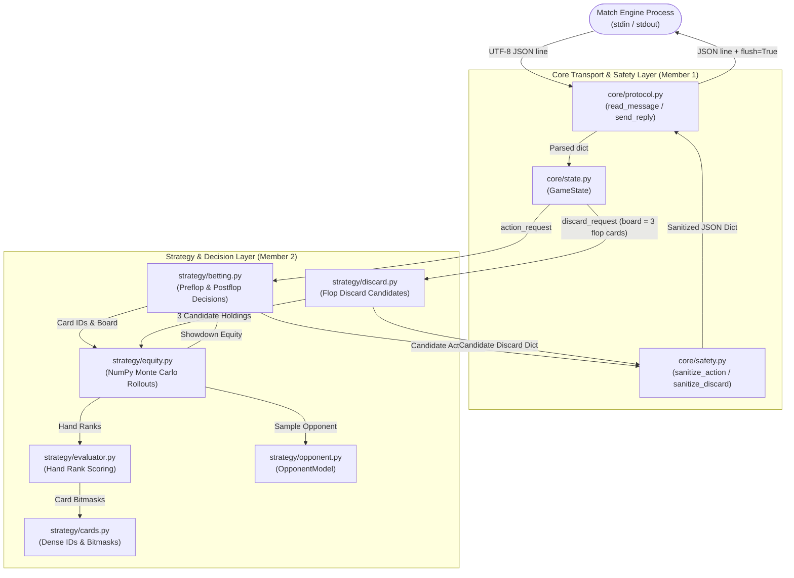

# Architecture Specification: Discard Hold'em Pokerbot

This document defines the system architecture, module boundaries, data flows, team ownership, and integration points for our Discard Hold'em tournament pokerbot.

> **Scope Notice:** This specification is derived strictly from the official **Pokerbots Rulebook** and **Protocol Specification**. The full Problem Statement (scheduled for release on 1st November) is not present in the repository; no undocumented rules or fields have been invented.

---

## 1. System Overview & Constraints

The tournament bot is an autonomous Python 3.11 agent designed to compete under the following constraints:
- **Runtime Environment:** Python 3.11, 1 vCPU, 1 GB RAM, read-only filesystem, zero network access.
- **Allowed Dependencies:** Python Standard Library, `numpy`, and `scipy` ONLY.
- **I/O Communication Protocol:** Line-delimited UTF-8 JSON via `sys.stdin` (engine messages) and `sys.stdout` (bot replies with `flush=True`). All debug output must be directed strictly to `sys.stderr` and kept under the 64 KB per-match limit.
- **Time Limits (Provisional):** 60 seconds cumulative time bank (Stage 1 / 400 hands) and 150 seconds (Stage 2 / ~1000 hands). Per-response limit: 5,000 ms. Target decision latency: **< 15 ms** per request.

---

## 2. Module Responsibilities & Directory Layout

```
pokerbot/
├── bot.py                  # Main entry point and IPC event loop
├── core/
│   ├── __init__.py
│   ├── protocol.py         # JSON transport, stdout flushing, stderr byte-capped logging
│   ├── state.py            # Authoritative match & hand state tracker (GameState)
│   └── safety.py           # Legality guard, range clamping, official fallback corrections
├── strategy/
│   ├── __init__.py
│   ├── cards.py            # Card conversions (str, dense int 0..51, 32-bit Cactus Kev bitmask)
│   ├── evaluator.py        # 5-card & 7-card hand strength evaluator algorithms
│   ├── equity.py           # Vectorized Monte Carlo equity engine
│   ├── discard.py          # Flop discard candidate evaluation engine
│   ├── betting.py          # Preflop heuristics & postflop pot-odds/SPR threshold betting
│   └── opponent.py         # Opponent modeling & independent discard simulation
├── tests/
│   ├── test_protocol.py    # Unit tests for protocol parsing and stderr capping
│   ├── test_cards.py       # Unit tests for card representations and conversions
│   ├── test_evaluator.py   # Unit tests for 5-card and 7-card hand evaluations
│   ├── test_equity.py      # Unit tests for Monte Carlo equity accuracy and dead card filters
│   ├── test_discard.py     # Unit tests for discard selection and no-leakage guarantees
│   ├── test_betting.py     # Unit tests for pot odds, preflop opening, and postflop actions
│   └── local_runner.py     # Adapter for official organiser starter kit match runner
├── training/
│   ├── kuhn_cfr.py         # Standalone offline baseline CFR on Kuhn Poker
│   ├── mccfr.py            # Standalone offline research MCCFR on abstracted subgames
│   └── experiments/        # Checkpoints and logs for offline exploration
└── documentation/
    ├── architecture.md     # System architecture, data flow, and boundaries
    └── decisions.md        # Architectural decisions, roadmap, and official rules vs choices
```

---

## 3. Data Flow & Execution Pipeline



---

## 4. Official Protocol Rules vs. Implementation Choices

### 4.1 Protocol Rules (Engine Invariants)
- **Cards:** 2-character strings `rank + suit` (e.g., `'As'`, `'Td'`, `'2c'`). Ace high.
- **Action Request:**
  - `legal_actions`, `min_raise`, `max_raise`, `raises_left` are authoritative from the engine.
  - Raise amount is a "to" amount (total committed on current street after action).
  - Maximum 4 bets/raises per street (BB is 1st preflop).
- **Discard Phase:**
  - `discard_request.board` contains **exactly the 3 flop cards**.
  - Discard occurs after flop betting round if no player folded. It occurs if both players are all-in, but NOT if a player folds before flop betting ends.
  - Discards are simultaneous and hidden until `discard_result`.
  - `discard_result` reveals both `my_discard` and `opp_discard` face-up and updates `hole_cards` to the 2 remaining cards.
- **Hand Result:**
  - `my_hole_cards` contains 3 cards if the hand ended before discard, 2 cards otherwise.
- **Notice Message:**
  - Engine notices are informational; no reply is expected.
- **Fallback Corrections:**
  - Illegal action -> corrected to check if legal (to_call == 0), else fold.
  - Illegal discard -> lowest-ranked card (2 lowest, ace highest). For equal rank, earliest suit in `spades, hearts, diamonds, clubs` is discarded.
- **Duplicate Deals:**
  - Deals swap cards between seats. Bot is not told which deals are duplicates, keeps no state between matches, and must not attempt to predict paired hands.

### 4.2 Implementation Choices (Not Official Rules)
- **Dense Card IDs (0..51) & 32-bit Cactus Kev Bitmasks:** Internal representations for $O(1)$ evaluation and array indexing.
- **Hand Evaluator Algorithm:** Prime product hash lookups and 21-combination evaluation for 7-card hands.
- **Opponent Modeling:** Tracking opponent VPIP/PFR and modeling independent discard logic without card leakage.
- **Monte Carlo Sampling:** Rollout iteration budgets (e.g. 150 rollouts) to respect the < 15 ms latency target.
- **Betting Sizing & Thresholds:** Pot fraction sizing (50–75% pot), equity thresholds (e.g. 0.68 value raise), and preflop range tiers.
- **Match Runner Adapter:** `tests/local_runner.py` is an adapter for the organiser's starter-kit runner; we do not implement a custom poker game engine.

---

## 5. Team Ownership & Collaboration Boundaries

| Member | Owned Scope | Branch Naming | Primary Responsibilities |
| :--- | :--- | :--- | :--- |
| **Member 1** | `core/` (`protocol.py`, `state.py`, `safety.py`), `bot.py` initial event loop, and `tests/local_runner.py`. | `feature/protocol-io`<br>`feature/local-runner` | Transport, protocol compliance, state maintenance, safety validation, fallbacks, and starter-kit runner integration. |
| **Member 2** | `strategy/` (`cards.py`, `evaluator.py`, `equity.py`, `discard.py`, `betting.py`, `opponent.py`). | `feature/evaluator`<br>`feature/discard-engine`<br>`feature/betting-strategy` | Mathematical card modeling, fast evaluation algorithms, Monte Carlo equity simulation, flop discard optimization, and betting heuristics. |
| **Joint / Both** | `tests/` unit suites, integration reviews, PR code reviews. | `bugfix/*` | Joint peer review on all Pull Requests; verifying test suites pass before merging into `main`. |
